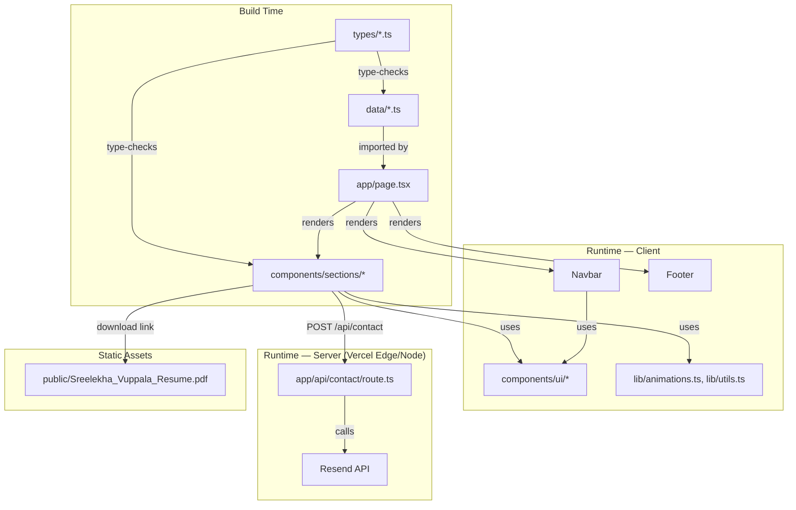
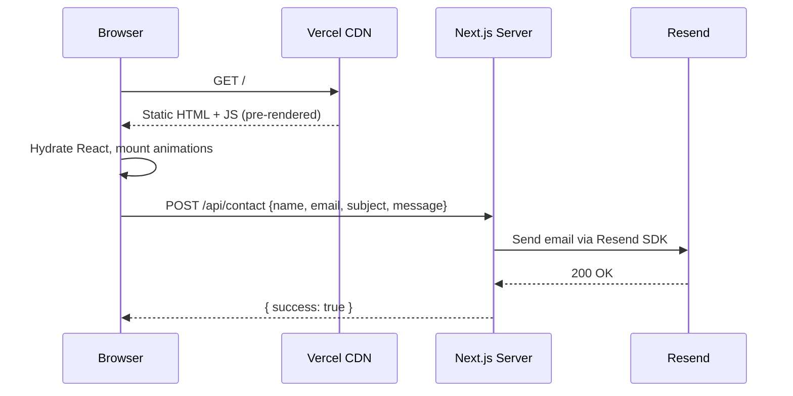
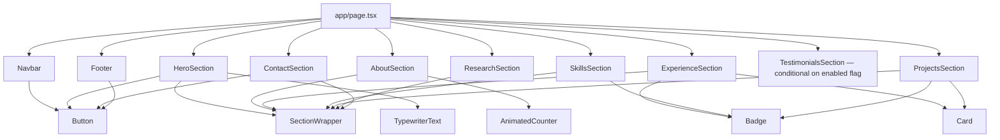
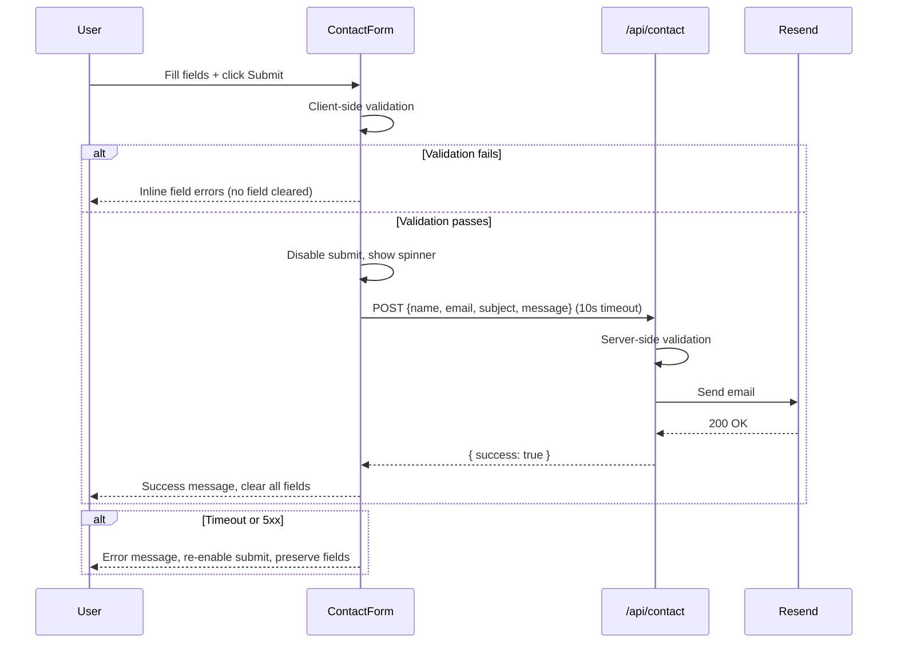

# Design Document — AI Engineer Portfolio

## Overview

This document describes the technical design for Sreelekha Vuppala's personal portfolio website — a production-quality, single-page application built with Next.js 14+ App Router, TypeScript strict mode, Tailwind CSS v3+, and Framer Motion v10+.

The site is a content-driven, statically generated portfolio with one dynamic API route (contact form). All personal content lives in `data/` TypeScript files. All TypeScript interfaces live in `types/`. All shared UI primitives live in `components/ui/`. Each section is a self-contained module in `components/sections/`.

**Core design principles applied throughout:**
- **KISS** — no abstractions beyond what the requirements demand
- **YAGNI** — no speculative features; the `enabled` flag is the only extensibility hook
- **SoC** — UI, data, business logic, and API routes are strictly separated
- **DRY** — `SectionWrapper`, animation variants, and Tailwind tokens are single sources of truth
- **SOLID** — each section is one file, one responsibility, interchangeable via a consistent interface
- **No console.log** — all client-side errors surface via UI state only; server-side API routes may use structured logging

---

## Architecture

### High-Level Architecture



### Request Flow



### Deployment Architecture

```mermaid
graph LR
    GH[GitHub Repository] -->|push to main| VERCEL[Vercel Build Pipeline]
    VERCEL -->|next build| STATIC[Static HTML/CSS/JS]
    VERCEL -->|serverless function| API_FN[/api/contact Route Handler]
    STATIC -->|served via| CDN[Vercel Edge CDN]
    API_FN -->|calls| RESEND_SVC[Resend Email Service]
    CDN -->|HTTPS| VISITOR[Visitor Browser]
    VISITOR -->|POST| API_FN
```

**Deployment constraints:**
- Vercel free tier — no paid add-ons
- Zero additional Vercel configuration beyond repository connection
- `RESEND_API_KEY` and `CONTACT_EMAIL_TO` stored as Vercel environment variables
- No database, no CMS, no external data fetching at runtime (except contact form POST)

---

## Components and Interfaces

### Component Hierarchy



### Section Component Contract

Every section component follows this interface contract (Liskov Substitution — sections are interchangeable):

```typescript
// Each section receives exactly its own typed data slice — no prop drilling
interface SectionProps<T> {
  data: T;
}
```

Sections are rendered in `app/page.tsx` as:

```tsx
<HeroSection data={heroData} />
<AboutSection data={aboutData} />
// etc.
```

No section imports from another section. Each section imports only from:
- `data/` (its own slice, passed as prop — sections do NOT import data directly)
- `components/ui/`
- `lib/`
- `types/`

### SectionWrapper — The DRY Animation Primitive

`SectionWrapper` is the single component responsible for scroll-triggered entrance animations. Every section uses it. No section duplicates animation logic.

```typescript
// components/ui/SectionWrapper.tsx
interface SectionWrapperProps {
  id: string;           // anchor ID for navigation
  className?: string;
  children: React.ReactNode;
  threshold?: number;   // viewport visibility threshold, default 0.2
}
```

Internally it uses `useInView` from Framer Motion and applies the `fadeInUp` variant from `lib/animations.ts`. It also fires a Vercel Analytics `track()` event when the section enters the viewport.

### Shared UI Primitives

| Component | Location | Responsibility |
|---|---|---|
| `SectionWrapper` | `components/ui/SectionWrapper.tsx` | Scroll-triggered animation wrapper + analytics tracking |
| `Button` | `components/ui/Button.tsx` | Styled button with variant (primary/secondary/ghost) and animated gradient border on primary |
| `Badge` | `components/ui/Badge.tsx` | Pill badge for skill tags and technology tags |
| `Card` | `components/ui/Card.tsx` | Elevated card with hover lift effect |
| `AnimatedCounter` | `components/ui/AnimatedCounter.tsx` | Counts from 0 to target value over 1.5s with easing |
| `TypewriterText` | `components/ui/TypewriterText.tsx` | Cycles through an array of strings with typewriter effect |
| `ParticleBackground` | `components/ui/ParticleBackground.tsx` | Canvas-based animated particle network for Hero |
| `NavBar` | `components/NavBar.tsx` | Fixed top nav with scroll-aware active link and blur effect |
| `Footer` | `components/Footer.tsx` | Site footer with copyright, nav links, social icons |
| `BackToTop` | `components/ui/BackToTop.tsx` | Fixed-position button, visible after scrolling past Hero |

### Navigation Data Contract

Navigation is data-driven. The nav bar reads from `data/navigation.ts`:

```typescript
// types/navigation.ts
export interface NavItem {
  label: string;
  href: string;        // anchor e.g. "#projects"
  sectionId: string;   // matches SectionWrapper id prop
}
```

Adding a new section requires: (1) new section file, (2) one entry in `data/navigation.ts`, (3) one `<NewSection />` tag in `app/page.tsx`. Nothing else changes.

---

## Data Models

All content is defined as TypeScript objects in `data/`. All shapes are defined as interfaces in `types/`. The compiler enforces that data matches its interface — adding a field to data without updating the interface (or vice versa) is a compile error.

### types/hero.ts

```typescript
export interface HeroData {
  enabled: boolean;
  name: string;
  roles: string[];                  // cycled by TypewriterText
  tagline: string;                  // ≤200 chars
  ctaButtons: {
    viewWork: { label: string; href: string };
    resume: { label: string; filename: string };
  };
  socialLinks: {
    github: string;
    linkedin: string;
  };
  avatarImage: {
    src: string;
    alt: string;
  };
  resumeVersionDate: string;        // "MMMM YYYY" format
}
```

### types/about.ts

```typescript
export interface AboutStat {
  label: string;
  value: number;
  suffix?: string;   // e.g. "+"
}

export interface AboutData {
  enabled: boolean;
  bio: string[];                    // array of 3–4 paragraph strings
  image: { src: string; alt: string };
  stats: AboutStat[];
  currentlyWorkingOn: string;
  // Branding guidance in inline comments co-located in data/about.ts
}
```

### types/experience.ts

```typescript
export type ExperienceType = 'work' | 'education';

export interface ExperienceEntry {
  type: ExperienceType;
  company: string;
  role: string;
  dateRange: string;
  achievements: string[];
  technologies: string[];
  accentColor?: string;             // optional per-entry override
}

export interface ExperienceData {
  enabled: boolean;
  entries: ExperienceEntry[];
}
```

### types/skills.ts

```typescript
export interface Skill {
  name: string;
  iconUrl?: string;                 // optional logo/icon path
}

export interface SkillCategory {
  category: string;
  icon: string;                     // emoji or icon name
  accentColor: string;
  skills: Skill[];
}

export interface SkillsData {
  enabled: boolean;
  categories: SkillCategory[];
}
```

### types/projects.ts

```typescript
export interface ProjectLink {
  github?: string;
  demo?: string;
}

export interface ProjectEntry {
  id: string;
  title: string;
  description: string;              // ≤160 chars
  technicalSummary: string;         // ≤280 chars, shown on hover overlay
  technologies: string[];
  links: ProjectLink;
  thumbnail?: string;               // path to image in public/
  featured: boolean;
  detail: {
    description: string;
    architecture: string;
    keyDecisions: string;
    challengesSolved: string;
    outcomeImpact: string;
  };
}

export interface ProjectsData {
  enabled: boolean;
  projects: ProjectEntry[];
}
```

### types/research.ts

```typescript
export interface Publication {
  title: string;
  venue: string;
  date: string;                     // ISO 8601
  abstract: string;                 // ≤300 chars
  url: string;
}

export interface ResearchData {
  enabled: boolean;
  interests: string[];
  publications: Publication[];      // empty array = "Coming Soon" placeholder
  currentlyReading: string[];       // empty array = subsection hidden
  githubUrl: string;
}
```

### types/contact.ts

```typescript
export interface ContactData {
  enabled: boolean;
  invitationText: string;
  email: string;
  linkedin: string;
  github: string;
}
```

### types/testimonials.ts

```typescript
export interface Testimonial {
  name: string;
  role: string;
  company: string;
  quote: string;
  avatarUrl?: string;
}

export interface TestimonialsData {
  enabled: boolean;                 // false = section excluded from render and nav
  testimonials: Testimonial[];
}
```

### types/navigation.ts

```typescript
export interface NavItem {
  label: string;
  href: string;
  sectionId: string;
}

export interface SiteMetadata {
  title: string;
  description: string;
  ogImage: string;
  siteUrl: string;
  resumeVersionDate: string;
}
```

### Feature Flag Pattern

Every section data object has an `enabled: boolean` field. The root page reads this flag before rendering:

```tsx
// app/page.tsx (simplified)
{testimonialsData.enabled && <TestimonialsSection data={testimonialsData} />}
```

The nav bar also filters nav items by checking the corresponding section's `enabled` flag. This is the only extensibility hook — YAGNI-safe, no complex plugin system needed.

---

## API Design — Contact Form Route

### Route: POST /api/contact

**File:** `app/api/contact/route.ts`

**Request body:**
```typescript
interface ContactFormPayload {
  name: string;
  email: string;
  subject: string;
  message: string;
}
```

**Validation (server-side, mirrors client-side rules):**
- `name`: 1–100 characters, non-empty after trim
- `email`: contains `@`, matches basic email pattern
- `subject`: 1–150 characters
- `message`: 20–1000 characters

**Success response (200):**
```json
{ "success": true }
```

**Validation error response (400):**
```json
{ "success": false, "errors": { "email": "Invalid email address" } }
```

**Server error response (500):**
```json
{ "success": false, "message": "Failed to send message. Please try again." }
```

**Implementation:**

```typescript
// app/api/contact/route.ts
import { Resend } from 'resend';
import { NextRequest, NextResponse } from 'next/server';

const resend = new Resend(process.env.RESEND_API_KEY);

export async function POST(req: NextRequest) {
  const body = await req.json();
  const validation = validateContactPayload(body);
  if (!validation.valid) {
    return NextResponse.json({ success: false, errors: validation.errors }, { status: 400 });
  }

  try {
    await resend.emails.send({
      from: 'Portfolio Contact <onboarding@resend.dev>',
      to: process.env.CONTACT_EMAIL_TO!,
      subject: `[Portfolio] ${body.subject}`,
      text: `From: ${body.name} <${body.email}>\n\n${body.message}`,
    });
    return NextResponse.json({ success: true });
  } catch {
    // No console.log — error is silent server-side beyond the 500 response
    return NextResponse.json(
      { success: false, message: 'Failed to send message. Please try again.' },
      { status: 500 }
    );
  }
}
```

**Security notes:**
- `RESEND_API_KEY` is a server-only environment variable — never exposed to the client bundle
- No `console.log` or `console.error` in the route handler
- Server-side validation prevents malformed payloads reaching Resend
- 10-second client-side timeout enforced via `AbortController` in the form component

### Contact Form Client Flow



---

## Animation System

All animation configuration lives in `lib/animations.ts` — the single source of truth. No section or component defines its own Framer Motion variants inline.

### lib/animations.ts

```typescript
import { Variants } from 'framer-motion';

// Respects prefers-reduced-motion at the variant level
// SectionWrapper checks window.matchMedia before applying variants

export const fadeInUp: Variants = {
  hidden: { opacity: 0, y: 20 },
  visible: {
    opacity: 1,
    y: 0,
    transition: { duration: 0.4, ease: 'easeOut' },
  },
};

export const staggerContainer: Variants = {
  hidden: {},
  visible: {
    transition: { staggerChildren: 0.1 },
  },
};

export const staggerContainerSlow: Variants = {
  hidden: {},
  visible: {
    transition: { staggerChildren: 0.15 },  // 150ms for Experience entries
  },
};

export const staggerBadge: Variants = {
  hidden: {},
  visible: {
    transition: { staggerChildren: 0.05 },  // 50ms for skill badges
  },
};

export const heroSequence: Variants = {
  hidden: { opacity: 0, y: 24 },
  visible: (custom: number) => ({
    opacity: 1,
    y: 0,
    transition: { delay: custom * 0.2, duration: 0.4, ease: 'easeOut' },
  }),
};

export const cardHover = {
  y: -4,
  boxShadow: '0 8px 32px 0 rgba(6, 182, 212, 0.25)',
  transition: { duration: 0.2 },
};
```

### Reduced Motion

`SectionWrapper` checks `prefers-reduced-motion` on mount:

```typescript
const prefersReduced = window.matchMedia('(prefers-reduced-motion: reduce)').matches;
const animate = prefersReduced ? 'visible' : inView ? 'visible' : 'hidden';
```

When reduced motion is preferred, all elements render immediately in their final `visible` state — no transitions, no delays.

### Animation Inventory

| Section | Variant Used | Trigger | Stagger |
|---|---|---|---|
| Hero | `heroSequence` (custom delay per element) | Page load | 200ms sequential |
| About | `fadeInUp` + `staggerContainer` | 20% in viewport | 100ms |
| Experience | `fadeInUp` + `staggerContainerSlow` | 20% in viewport | 150ms |
| Skills | `fadeInUp` + `staggerBadge` | 10% in viewport | 50ms per badge |
| Projects | `fadeInUp` + `staggerContainer` | 20% in viewport | 100ms |
| Research | `fadeInUp` + `staggerContainer` | 20% in viewport | 100ms |
| Contact | `fadeInUp` | 20% in viewport | — |
| NavBar | CSS transition (not Framer Motion) | scroll > 64px | — |

---

## Directory Structure

```
e:\Portfolio2\
├── app/
│   ├── layout.tsx              # Root layout: metadata, fonts, Analytics provider
│   ├── page.tsx                # Single page: renders all sections in order
│   ├── globals.css             # Tailwind base/components/utilities + custom CSS
│   └── api/
│       └── contact/
│           └── route.ts        # POST /api/contact — Resend integration
│
├── components/
│   ├── NavBar.tsx              # Fixed top navigation bar
│   ├── Footer.tsx              # Site footer
│   ├── sections/
│   │   ├── HeroSection.tsx
│   │   ├── AboutSection.tsx
│   │   ├── ExperienceSection.tsx
│   │   ├── SkillsSection.tsx
│   │   ├── ProjectsSection.tsx
│   │   ├── ResearchSection.tsx
│   │   ├── ContactSection.tsx
│   │   └── TestimonialsSection.tsx   # Rendered only when enabled: true
│   └── ui/
│       ├── SectionWrapper.tsx        # Scroll-triggered animation + analytics
│       ├── Button.tsx
│       ├── Badge.tsx
│       ├── Card.tsx
│       ├── AnimatedCounter.tsx
│       ├── TypewriterText.tsx
│       ├── ParticleBackground.tsx
│       └── BackToTop.tsx
│
├── data/
│   ├── hero.ts                 # HeroData — includes resumeVersionDate
│   ├── about.ts                # AboutData — includes branding comments
│   ├── experience.ts           # ExperienceData
│   ├── skills.ts               # SkillsData
│   ├── projects.ts             # ProjectsData — includes branding comments
│   ├── research.ts             # ResearchData
│   ├── contact.ts              # ContactData
│   ├── testimonials.ts         # TestimonialsData (enabled: false by default)
│   ├── navigation.ts           # NavItem[]
│   └── metadata.ts             # SiteMetadata (OG tags, title, description)
│
├── types/
│   ├── hero.ts
│   ├── about.ts
│   ├── experience.ts
│   ├── skills.ts
│   ├── projects.ts
│   ├── research.ts
│   ├── contact.ts
│   ├── testimonials.ts
│   └── navigation.ts
│
├── lib/
│   ├── animations.ts           # All Framer Motion variants — single source of truth
│   ├── utils.ts                # cn() classname helper (clsx + tailwind-merge)
│   └── scroll.ts               # Smooth scroll with nav offset utility
│
├── public/
│   ├── Sreelekha_Vuppala_Resume.pdf
│   ├── avatar.jpg              # Profile photo
│   ├── og-image.png            # Open Graph image
│   └── projects/               # Project thumbnails
│       ├── contract-agent.png
│       ├── rag-system.png
│       └── gemma-email.png
│
├── .env.example                # Documents RESEND_API_KEY, CONTACT_EMAIL_TO
├── .env.local                  # Local secrets (gitignored)
├── tailwind.config.ts          # Design tokens: colors, fonts, spacing
├── tsconfig.json               # TypeScript strict mode
├── next.config.ts              # Next.js config
├── CONTENT_GUIDE.md            # Numbered update instructions per section
└── README.md                   # Setup, dev, deploy, content update guide
```

---

## Error Handling

### Client-Side Error Handling

All errors surface via UI state — no `console.log`, `console.error`, or `console.warn` anywhere in client-side code.

| Scenario | Handling |
|---|---|
| Contact form validation failure | Inline error message adjacent to each failing field; no fields cleared |
| Contact form API timeout (>10s) | Error message displayed, submit re-enabled, all field values preserved |
| Contact form API 5xx | Same as timeout — descriptive error message, retry possible |
| Resume PDF not found | "Download Resume" CTA hidden (checked at build time via `fs.existsSync`) |
| Image load failure | `alt` text displayed; no broken image icon |
| TypewriterText empty array | Renders nothing gracefully |
| Research publications empty | "Coming Soon" placeholder rendered |
| `currentlyReading` empty | Subsection not rendered |

### Resume PDF Build-Time Check

The resume CTA visibility is determined at build time in `app/page.tsx`:

```typescript
import { existsSync } from 'fs';
import path from 'path';

// This runs server-side at build time (Next.js SSG)
const resumeExists = existsSync(
  path.join(process.cwd(), 'public', 'Sreelekha_Vuppala_Resume.pdf')
);
```

`resumeExists` is passed as a prop to `HeroSection` and `NavBar`. When `false`, the CTA is not rendered — no broken link, no 404.

### Server-Side Error Handling (API Route)

The `/api/contact` route handler catches all errors from the Resend SDK and returns a structured JSON error response. No error details are leaked to the client beyond a generic retry message. No `console.log` in the route handler.

---

## Testing Strategy

> **Note:** Per the MVP scope defined in the requirements, no automated test framework is set up as part of this spec. The testing strategy below describes manual test checkpoints and the locations where automated tests would be added post-MVP.

### Manual Test Checkpoints

**Foundation**
- [ ] `npm run build` completes with zero TypeScript errors
- [ ] `npm run dev` starts on port 3000 (default); if port is in use, the user is notified — port is NOT changed programmatically
- [ ] All sections render with correct content from data files

**Visual / Responsive**
- [ ] Dark mode renders correctly at 320px, 768px, 1280px viewport widths
- [ ] No horizontal overflow at any breakpoint
- [ ] NavBar transitions from transparent to blurred opaque after 64px scroll
- [ ] Active nav link indicator updates as sections scroll into view
- [ ] Hero section occupies 100vh on desktop, ≥90vh on mobile

**Animations**
- [ ] Hero entrance sequence completes within 1.5 seconds
- [ ] Section entrance animations trigger at correct viewport thresholds
- [ ] All animations disabled when `prefers-reduced-motion: reduce` is set
- [ ] Hover effects on cards and buttons work on pointer devices

**Contact Form**
- [ ] Client-side validation shows inline errors for each invalid field
- [ ] Valid submission shows loading spinner, disables submit button
- [ ] Successful submission shows confirmation message and clears fields
- [ ] Failed submission (network off) shows error message, re-enables submit, preserves fields
- [ ] 10-second timeout triggers error state

**Resume Download**
- [ ] "Download Resume" triggers file download, does not navigate away
- [ ] If PDF removed from `/public`, CTA is hidden (requires rebuild to verify)

**Accessibility**
- [ ] All interactive elements reachable via keyboard Tab
- [ ] Focus indicators visible on all interactive elements
- [ ] All informative images have non-empty `alt` attributes
- [ ] Lighthouse Accessibility score ≥ 90

**SEO / Meta**
- [ ] `<title>` and `<meta name="description">` present on page
- [ ] All five OG tags and four Twitter Card tags present in `<head>`
- [ ] `sitemap.xml` and `robots.txt` accessible at site root

### Post-MVP Automated Testing (Recommended)

When a test suite is added, the following areas are highest priority:
- `validateContactPayload()` utility function — pure function, ideal for unit tests
- `TypewriterText` component — cycling behavior
- `AnimatedCounter` — counter increment logic
- Project tag filter logic in `ProjectsSection`
- `/api/contact` route handler — with Resend SDK mocked


---

## Correctness Properties

> **Note:** Per the MVP scope, no automated test framework is set up as part of this spec. The properties below are formal specifications of correct behavior — they serve as the authoritative reference for manual testing and as the foundation for property-based tests when a test suite is added post-MVP. Each property is universally quantified and directly traceable to acceptance criteria.

*A property is a characteristic or behavior that should hold true across all valid executions of a system — essentially, a formal statement about what the system should do. Properties serve as the bridge between human-readable specifications and machine-verifiable correctness guarantees.*

---

### Property 1: TypewriterText cycles through all roles

*For any* non-empty array of role strings passed to the `TypewriterText` component, after a sufficient number of display cycles, every string in the array should have been displayed at least once, and the cycling order should match the array order.

**Validates: Requirements 3.2**

---

### Property 2: Resume CTA visibility matches PDF existence

*For any* boolean value of `resumeExists` (derived from whether the PDF file is present at build time), the "Download Resume" CTA should be rendered in the Hero section and navigation bar if and only if `resumeExists` is `true`. When `resumeExists` is `false`, no link or button referencing the resume PDF should appear in the rendered output.

**Validates: Requirements 3.9, 13.5**

---

### Property 3: AnimatedCounter reaches exact target value

*For any* positive integer `target` value passed to the `AnimatedCounter` component, after the animation duration (1.5 seconds) has elapsed, the displayed value should equal exactly `target`. The counter should start at 0 and never display a value greater than `target` during the animation.

**Validates: Requirements 4.3**

---

### Property 4: Data-driven rendering — content appears in correct section

*For any* content item (skill, project, research interest, experience entry) added to its corresponding data array in the `data/` directory, the rendered output of the corresponding section component should contain that item's primary display text in the correct section. Conversely, removing an item from the data array should result in that item's text not appearing in the rendered output.

**Validates: Requirements 1.5, 6.3, 7.6, 15.4**

---

### Property 5: No proficiency indicators rendered for any skill

*For any* `SkillsData` object, regardless of the number of categories or skills it contains, the rendered `SkillsSection` output should contain no progress bar elements, no percentage values adjacent to skill names, and no visual elements that imply relative skill level between skills.

**Validates: Requirements 6.5, 6.6**

---

### Property 6: Project detail view contains all five required sections

*For any* `ProjectEntry` in the data array, navigating to that project's detail view should render exactly five labeled sections — project description, architecture overview, key technical decisions, challenges solved, and outcome/impact — each with a visible heading and non-empty content string.

**Validates: Requirements 7.3**

---

### Property 7: Featured badge presence matches data flag

*For any* `ProjectEntry`, the presence of a "Featured" badge in the rendered project card should equal the boolean value of `project.featured`. If `featured` is `true`, the badge must be present. If `featured` is `false`, no "Featured" badge should appear on that card.

**Validates: Requirements 7.4**

---

### Property 8: Technology tag filter is a round-trip operation

*For any* technology tag `T` that appears in at least one project's `technologies` array: (a) after clicking tag `T`, every visible project card should include `T` in its technology list, and no project card lacking `T` should be visible; (b) after clicking tag `T` a second time to deselect it, all project cards should be visible again, matching the unfiltered state.

**Validates: Requirements 7.8**

---

### Property 9: Projects with no links render no link controls

*For any* `ProjectEntry` where both `links.github` and `links.demo` are absent (undefined or empty string), the rendered project card should contain no anchor elements or button elements that reference a project URL. No broken links, empty hrefs, or placeholder link controls should appear.

**Validates: Requirements 7.9**

---

### Property 10: Empty collections hide their UI containers

*For any* `ResearchData` where `publications` is an empty array, the rendered `ResearchSection` should display the "Coming Soon" placeholder text and should not render an empty list element. *For any* `ResearchData` where `currentlyReading` is an empty array, the "Currently Reading / Exploring" subsection heading and container should not be present in the rendered output.

**Validates: Requirements 8.2, 8.4**

---

### Property 11: Each publication renders all required fields

*For any* `Publication` entry in the `publications` array, the rendered output should contain: the publication title, the venue/platform name, the date string, an abstract snippet of no more than 300 characters, and an anchor element with a non-empty `href` pointing to the full content URL.

**Validates: Requirements 8.3**

---

### Property 12: Contact form validation correctly classifies all inputs

*For any* combination of `name` (string of any length), `email` (string of any content), `subject` (string of any length), and `message` (string of any length), the `validateContactPayload` function should return `valid: true` if and only if: `name` is 1–100 non-whitespace characters, `email` contains `@` and a valid domain, `subject` is 1–150 characters, and `message` is 20–1000 characters. All other combinations should return `valid: false` with errors identifying each failing field.

**Validates: Requirements 9.1**

---

### Property 13: Form field values preserved on validation failure and API error

*For any* form state (any combination of field values), if the form submission is rejected due to validation failure or if the API call returns an error or times out: all field values should remain exactly as the user entered them (no field is cleared or modified), and the submit button should be re-enabled. Only the error message UI state should change.

**Validates: Requirements 9.3, 9.7**

---

### Property 14: Informative images have non-empty alt attributes

*For any* image element rendered from a data file where the data object specifies the image as informative (i.e., the `alt` field is a non-empty string), the rendered `` element should have a non-empty `alt` attribute matching the data value. Decorative images (where `alt` is explicitly set to `""` in the data) should render with `alt=""`.

**Validates: Requirements 10.8**

---

### Property 15: Feature flag excludes section from render and navigation

*For any* section data object where `enabled` is `false`, the corresponding section component should not be present anywhere in the rendered page DOM, and no navigation item linking to that section should appear in either the top navigation bar or the footer navigation. Setting `enabled` back to `true` should cause both the section and its navigation item to appear without any other code changes.

**Validates: Requirements 11.2, 15.4**
